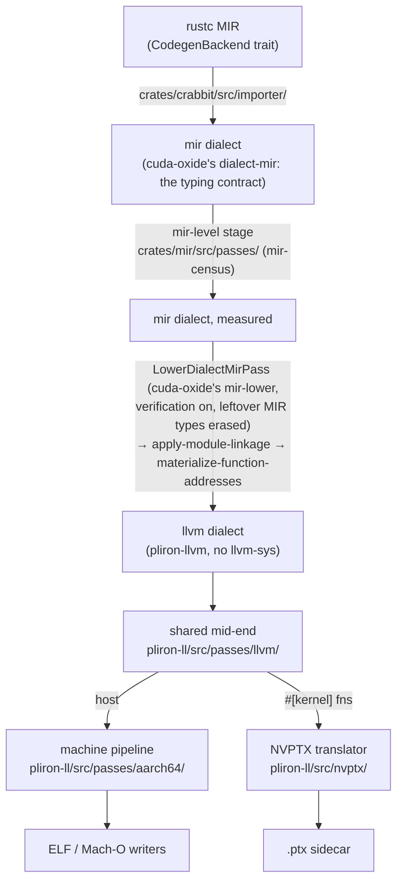

# Architecture

crabbit is a rustc codegen backend built as a stack of
[pliron](https://github.com/pliron-org/pliron) dialects and passes, plus a
toolchain (backward PGO, harness) built on the same stack. This
document maps the pipeline to the actual modules.



## 1. Import: MIR → `mir` dialect

One front end, crabbit's own, feeds both modules: `crates/crabbit/src/importer/`
walks the crate's monomorphized MIR and builds a `mir`-dialect module per
kind — the host module (`rust_crate`) and the kernel module
(`rust_kernels`, the cuda-oxide `#[kernel]` entries of `docs/KERNEL-ABI.md`,
written against the `cuda_device` API, which the importer intercepts into
`nvvm` dialect ops).
The dialect is cuda-oxide's `dialect-mir`, consumed unpatched from NVIDIA's
upstream repository; its verifier is the contract the importer meets, and
`mir-lower` checks the whole module against it before lowering anything
(`docs/MIR-DIALECT.md`). Constants (including pointer-carrying
allocations), TLS, virtual calls, i128 and overflow intrinsics are resolved
in the importer.

The importer's output is the dialect's ops over a mixed type vocabulary:
`mir.ptr` thin pointers, but LLVM aggregate types and llvm-dialect
aggregate ops (`undef`/`insert_value`/`extract_value`) for structs and fat
pointers, byte-addressed field access, and `llvm.func` declarations for
foreign symbols. The walk builds every thin pointer as the opaque byte
pointer `mir.ptr<u8>`; a typing pass at the end of the import
(`importer/typing.rs`) then gives each use the pointee the verifier
requires (representation-only `mir.cast PtrToPtr`), stamps the foreign
signature on calls to non-`mir.func` symbols (`external_callee_type`,
`AbiBoundary`), and bridges the two values the dialect has no producer for
on the host — addresses of globals/thread-locals (`llvm.addressof`, crossed
as exposed-provenance integer casts) and addresses of this module's
functions (`ll.func_addr`, materialized after the lowering). The
`mir-census` pass reports the remaining distance to the verifier as a
per-rule histogram; it is zero on the fixtures.

### 1a. The `mir`-level stage (`crates/mir/src/passes/`)

Between the importer and `LowerDialectMirPass` sits a pass stage over the
`mir` dialect itself (`crabbit_mir::passes::add_mir_passes`), added ahead
of every lowering: inside `add_midend_passes` (host and kernel pipelines)
and in the standalone `emit_lowered_ir` path that `CRABBIT_EMIT_IR` takes,
so each module passes through it exactly once.

Today the stage holds one pure analysis, **`mir-census`**
(`mir_census.rs`): per `mir.func` an op-kind histogram (full op ids, so
the importer's `llvm.*` spellings sit next to the `mir.*` ones), calls by
demangled callee and callee family (`core::iter`, `alloc::vec`, ...),
alloca/assert/checked-arithmetic counts, aggregate construction via
`mir.construct_*` versus `undef`+insert chains, natural-loop count and
nesting depth (pliron-ll's dialect-agnostic dominator/loop analysis), and
block/op totals, plus the module aggregation. `CRABBIT_MIR_CENSUS=<path>`
appends one JSON object per module to that file; unset, the walk is
skipped entirely. `CRABBIT_MIR_DISABLE=census` skips it like the mid-end
gate. It never fails a compile (errors go to stderr, the pass returns
unchanged). The census is the measurement behind the thin-importer plan:
it says which Rust-semantic constructs the importer still pre-lowers
(`docs/MIR-CENSUS.md`).

Constraints on anything added here, verified against the pinned
`mir-lower`: its conversion claims every `mir.*`/`nvvm.*` op and fails on
one it has no arm for; attributes on `mir` ops are not carried onto the
lowered ops, while the `builtin.module` op and its attributes survive. So
passes in this stage must not introduce `mir.*` op kinds the lowering
lacks, and anything that has to cross the lowering travels on the module —
function linkage does (`crabbit_linkage`, a symbol → linkage dictionary the
importer writes and `apply-module-linkage` stamps onto the `llvm.func`s
right after the lowering; every lowered function then carries an explicit
linkage, external where nothing was recorded). The lowering pass itself
erases the MIR types `mir-lower` leaves on the importer's llvm-dialect
aggregate ops (`mir.ptr`, signed and unsigned integers, named structs),
with `mir-lower`'s own type mapping, so every snapshot from there on is
valid LLVM dialect; `materialize-function-addresses` then turns
`ll.func_addr` into `llvm.addressof`.

## 2. Shared mid-end (`crates/pliron-ll/src/passes/llvm/`)

One default order (`passes::llvm::DEFAULT_ORDER`) serves the host
pipeline and the kernel pipeline, so they cannot
drift (section 3.1 for how an order is built and replaced):

```
op-ids → inline → simplify/simplify-cfg → 2 × (SROA → mem2reg → simplify rounds)
→ gvn → div-strength-reduce → licm → gvn → loop-carried-fwd → unroll
→ global-dse → adce → sink
→ final simplify/simplify-cfg/simplify → vectorize
```

- `analysis.rs`: dominators (pliron's CHK), post-dominators, natural loops,
  a generic backward bitset dataflow.
- `gvn.rs` / `dse.rs` share one conservative syntactic alias model
  (`AddrKey`).
- Profitability is parameterized by **`TargetProfile`**
  (`pliron-ll/src/target_profile.rs`) — a miniature TargetTransformInfo.
  First consumer: `sink.rs` refuses to add control dependence when
  `has_branch_divergence` (SIMT executes both sides of a divergent guard;
  measured +10% regression on `gemm_tiled` before the rule, see
  `MIDEND-PLAN.md`).
- Each optimization pass self-ablates via `CRABBIT_MIDEND_DISABLE`
  (`midend_gate.rs`).

## 3. Machine pipelines and the target registry

`pliron-ll/src/targets.rs` is an LLVM-style registry: a `Triple` resolves
to a `TargetBackend` bundling the default order of its machine pipeline,
its machine passes by name, and an object writer. The aarch64 order
(`passes/aarch64/mod.rs`):

```
verify → abi → isel (llvm_to_aarch64_isel.rs) → legalize
→ machine-cfg-cleanup → target-opts-pre-ra
→ [blockmap/op-id stamping]
→ register allocation (aarch64-register-allocate)
→ frame-lower → post-ra-opts → block-placement
→ branch-relax → asm-lower → encode
```

Every machine block ends in one terminator that names all its successors
(`b`; `b_cond`/`cbnz` with their taken and not-taken blocks; `ret`;
`brk`), as pliron's CFG model requires. Block placement only orders blocks;
the encoder turns the edge to the next block into a fall-through (a `b` to
it is no bytes, a `b_cond` whose taken block is next is inverted).

ELF/Mach-O translation happens outside the pass pipeline
(`aarch64_object_lower.rs`, `elf.rs`, `macho.rs`), like the PTX writer.
The linear allocator's spill policy and block frequencies are options
(`codegen_opts.rs`): uniform, analytic spectral
(`passes/spectral_freq.rs`), or a **measured profile**
(`passes/profile_freq.rs`, read from the profiled trace named by
`CRABBIT_PROFILE`).

### 3.1 Pipelines as orders of named passes (`crates/config`)

A compilation is described by a `CrabbitConfig`: the host target (the
triple rustc compiles for), the device target (`nvptx64-nvidia-cuda` for
the kernel module) and the crate name. Each pipeline stage — `MirToLlvm`,
`Midend`, and on the host side `Machine` — is an order of pass names;
the crates that define passes also define the default orders
(`crabbit_mir::passes::DEFAULT_ORDER`, `passes::llvm::DEFAULT_ORDER`, each
backend's machine order) and build passes by name. crabbit-config builds
a stage from its effective order, and any crate can extend it:
`register_pass(name, factory)` adds a pass (a factory gets the config and
the side it builds for), `register_order(f)` decides every stage's order —
`f` receives crabbit's default and may insert, remove, reorder or replace
passes, crabbit's own included (replacing `aarch64-register-allocate`
swaps the allocator). The registrations happen in the codegen-backend
dylib rustc loads; `docs/EXTENDING.md` shows the whole recipe. The plain
`libcrabbit.so` registers nothing and runs the defaults.

Running a pipeline is pliron's pass manager (`Passes`, `PassManager`
hooks: `PMConfig` printing, verification, timing, skipping by name);
crabbit adds only building from an order.

## 4. GPU kernel path

Kernel functions take the same mid-end (with
`TargetProfile::gpu_kernel()`), then `pliron-ll/src/nvptx/mod.rs`
translates llvm-dialect functions **directly to PTX text** — no NVVM, no
LLVM; ptxas does register allocation downstream. Integers, f32/f64,
`.shared` memory (`SharedArray` statics), barriers,
atomics, and the NVVM math/sreg intrinsics are covered; unsupported
constructs error by name. `CRABBIT_LL_OUT` additionally exports the same
module as textual LLVM IR (`crates/crabbit/src/kernel_llvm_export.rs`) so
the identical front half can be compiled by `llc` — the apples-to-apples
"rust-llvm" comparison arm.

## 5. Provenance & backward PGO

The substrate of [BACKWARD-PGO.md](BACKWARD-PGO.md), gated by
`CRABBIT_PROFILE_MAP`:

- `llvm-op-ids` stamps every mid-end-input op; each transforming pass
  records where what it created came from (`ll.derived_from`,
  multi-parent `ll.derived_from_many`, `ll.inlined_from`) next to its own
  code.
- The machine boundary (`passes/aarch64/opmap.rs`) re-stamps: isel brackets
  every emitted machine op with its source op; RA and frame lowering stamp
  the code they create (or named synthetic roots: `isel:abi`, `regalloc`,
  `frame`). Machine blocks get their RA-time position
  (`passes/aarch64/blockmap.rs`).
- Backward passes (`crates/pliron-bpgo`: `BackwardPass`, `walk`): each is
  paired with a forward pass by name and puts the profile of the pass's
  output on its input, reading back its forward pass's stamps. crabbit's
  live next to their forward passes (`passes/aarch64/backward.rs`,
  `passes/llvm/backward.rs`).
- `crabbit-bpgo` (`crates/bpgo`) measures a run with `perf`, walks the
  trace of the build, and writes the profiled trace.
- The GPU path maps PTX lines to source ops (`<ptx>.linemap.json`,
  `CRABBIT_PTX_LINEMAP`), verified not to perturb codegen; it has no
  backward passes yet.
- Consumers: measured block frequencies (`CRABBIT_BLOCK_FREQ=profile`),
  allocators that read measured per-decision costs, and the analyses
  under `kernel-corpus/results/`.

## 6. Traces

With `CRABBIT_TRACE=1`, pliron's pass manager prints the module after every
pass (`PMConfig::print_after_all`), and crabbit assembles the printouts into
one trace file (`.crt`, format in `crates/pliron-trace`): a JSON header
(crate, target, the pipeline's pass names) followed by the IR before the
first pass and after each pass. Traces go to `.crabbit-traces/` at the root
of the compiled project (`CRABBIT_TRACE_DIR` overrides). A profiled trace
(`<version>.bpgo.crt`) is the same trace with the profile of every snapshot
reached in its header.
[pliron-inspect](https://github.com/montaglue/pliron-inspect) shows them in
the browser.

## 7. Verification & measurement

- `crates/backend-tests`: builds the real dylib, compiles fixture crates
  through it, **executes them**, and checks output — including a GPU kernel
  fixture run via the CUDA driver API, and IR round-trip fixpoint. Runs
  under both allocator engines.
- `crates/pliron-ll/tests/backward_pgo.rs`: backward-PGO fidelity (E3) —
  synthetic cycles on machine code must come back onto the correct
  source ops through the full traced pipeline, including a 50/50
  GVN-merge split, with the total conserved at every snapshot.
- `scripts/perf-harness/`: config-matrix A/B over fixtures + arrow-rs +
  the kernel-corpus CPU variants; miscompile gates; objdump spill metrics
  (whole-object and per-kernel-function); backend snapshotting so a sweep
  can never mix compiler versions.
- `../kernel-corpus`: 14 kernels × {Rust device, Rust CPU, CUDA C++, spec}
  with checksum gates; the three-arm GPU comparison
  (`tools/run_all.py`); the attribution and feedback experiments with all
  raw CSVs.
